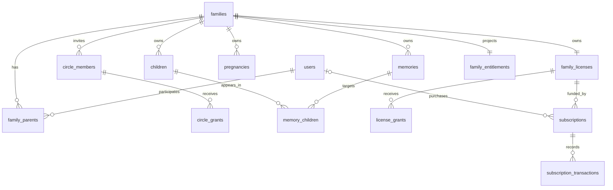

# Thiết kế database Baby Family

Phân tích ngày **2026-10-13**; cập nhật cấu trúc backend, persistence và quy tắc migration ngày **2026-10-14** · BF-20261013-004/005/006, BF-20261014-001/002.

## Trạng thái và cách đọc

Thiết kế đã được đưa vào **Prisma schema và forward migration của backend**, đối chiếu đặc tả nghiệp vụ/kỹ thuật và canvas `desgin/appdesgin.pen`. Migration domain **chưa áp dụng lên database ứng dụng đang chạy**. Đợt BF-20261014-003 bổ sung [service/controller và auth boundary](../../baby-backend/docs/api.md); có bảng/service nền không có nghĩa mọi authorization, billing integration, worker hoặc tính năng tương ứng đã được triển khai.

Đã có model class, I-repository/token, concrete repository và DI tương ứng đủ 123 bảng (122 domain + Note). Xem [persistence manifest](../../baby-backend/src/database/persistence.manifest.ts), [DI providers](../../baby-backend/src/database/repository.providers.ts) và [hướng dẫn bảo trì](../../baby-backend/README.md#cấu-trúc-và-oop). Repository giữ persistence; nghiệp vụ/quyền nằm ở service. Các bảng lịch sử/tài chính không mở generic update/delete.

- [Yêu cầu nghiệp vụ và traceability](requirements.md): tính năng, BR/AC, dữ liệu, phase và các điểm mâu thuẫn.
- [Đối chiếu thiết kế thực tế](design-coverage.md): màn/frame ID và nội dung đọc qua Pencil MCP; phân biệt UI minh họa với luồng đã đặc tả.
- [License và billing theo family](billing.md): quyền sở hữu, giao dịch, restore, quota và các quyết định còn cần xác nhận.
- [Prisma schema](../../baby-backend/prisma/schema.prisma): schema thực tế của backend, giữ `Note` trong `public` và các domain schema.
- [Forward migration](../../baby-backend/prisma/migrations/20261013150000_family_domain/migration.sql): **chỉ DDL**; giữ trigger/check/partial index ngoài khả năng biểu đạt của Prisma.
- [Catalog seed](../../baby-backend/prisma/seed.ts): dữ liệu khởi tạo chạy riêng qua `npm run db:seed`, không chạy tự động khi migrate hoặc khởi động API.
- [Kiểm chứng SQL cách ly](../../baby-backend/test/database-design/validate.sh): assertions và scenarios ở cùng thư mục; không chạy trên DB ứng dụng.
- [Data dictionary](data-dictionary.md): bảng, trường, khóa và index của bản DDL đã kiểm chứng.
- [Kết quả xác minh](verification.md): môi trường cách ly, kiểm tra thực chạy và giới hạn.

Thứ tự ưu tiên: quyết định mới nhất của người dùng → quyết định C/BR/AC đã chốt → luồng nghiệp vụ → thiết kế màn hình → ví dụ kỹ thuật cũ. Không lấy số liệu mock, câu chữ trang trí hay một nút trên UI làm bằng chứng về quy tắc chưa được chốt.

## Quyết định nền tảng

1. **Family là tenant và chủ license.** User là danh tính toàn hệ thống, có thể làm Parent của một family và Circle của nhiều family. Quyền lợi không nằm trên `users.is_pro` hoặc theo family hiện tại của người thanh toán.
2. Hai Parent dùng slot **A/B**, nhãn Papa/Mama độc lập với slot và giới tính. Không ràng buộc một nam + một nữ; đặc tả cho phép các cách gọi khác nhau. Một user có tối đa một Parent membership đang hoạt động.
3. Family lifecycle, membership, license và trạng thái thanh toán là các khái niệm riêng. Family `PARTNER_LEFT` có thể vẫn còn thời gian đã trả; entitlement trả phí không tự mở khóa nghiệp vụ cần đủ hai Parent.
4. PostgreSQL là nguồn sự thật cho quan hệ, quyền, quota, giao dịch, job history và intent phát sự kiện. Redis phục vụ cache/queue; object storage giữ file; MongoDB nếu triển khai chỉ là projection/log TTL, không tham gia transaction nghiệp vụ với PostgreSQL.
5. Chuẩn hóa các quan hệ có quyền/FK/truy vấn: bảng nối tường minh, không lưu mảng ID thay cho quan hệ. JSONB chỉ cho nội dung cấu hình, bản dịch, snapshot hoặc payload có schema; không thay FK/constraint cho dữ liệu cốt lõi.
6. Mọi bảng dự án, gồm bảng nối/history/config, có `created_at`, `updated_at`, `deleted_at` theo [chuẩn bắt buộc](../../.agents/skills/baby-family-team/references/database-standards.md). Soft delete không có nghĩa được sửa/xóa ledger tài chính hoặc Hearts tùy ý.
7. Theo BF-20261013-005: House/Family là hai gói trả phí ban đầu, catalog có thể thêm gói; trial mặc định **7 ngày** từ policy/version. License không chuyển family trong bất kỳ trường hợp nào; paid renewal sau payer deletion vẫn thuộc family gốc. [Chuẩn mở rộng](../../.agents/skills/baby-family-team/references/extensibility-standards.md) áp dụng cả server và client.

Avatar AUTH-04 và file đính kèm hỗ trợ dùng `user_assets` thuộc user, độc lập family; không tạo family giả chỉ để upload ảnh trước onboarding/CIR-WAIT. Media ký ức vẫn thuộc `assets` có `family_id NOT NULL`; quyền ký URL, giới hạn file và retention của hai scope phải riêng.

Schema/migration tập trung **MVP và các phần 1.1/1.2 đã mô tả đủ cấu trúc**, không bật feature chỉ vì đã có bảng. Growth measurements (CHD-06, 1.2), care handoff (1.1) và Year Story/book export (2.0) có traceability trong requirements nhưng cần thiết kế chi tiết/migration riêng khi triển khai; chưa đầy đủ mọi phase. Config/banner/feature flags dùng catalog/config hiện có trước khi cần bảng chuyên biệt.

## Tổ chức dữ liệu

Giữ bốn schema trong cùng PostgreSQL database để giao dịch liên miền vẫn nguyên tử, chưa tách microservice/database:

| Schema    | Trách nhiệm                                                                                                                                  |
| --------- | -------------------------------------------------------------------------------------------------------------------------------------------- |
| `app`     | Identity/session/consent, family/membership/grants, thai kỳ/bé, media/ký ức, lịch, care, recap, dữ liệu thông báo cần bền vững và lifecycle. |
| `us`      | Papa & Mama: mood, lời nhờ, cảm ơn, nhật ký riêng, cầu nối, tên con và khóa mã hóa; cô lập khỏi feed/search/export gia đình.                 |
| `billing` | Catalog gói có version, Store products, purchase intent, family license/grants, subscription/transaction/webhook, trial và usage.            |
| `ops`     | Catalog/config/admin/audit, outbox, sync, idempotency, job run/attempt và vận hành.                                                          |

Tên bảng snake_case số nhiều; cột `_id` có FK khi là quan hệ. TypeScript dùng tên class/property camelCase và `@map`/`@@map`/`@@schema`. UUID cho entity và khóa đồng bộ offline; có thể dùng bigint identity cho ledger/outbox tăng nhanh. Domain schema mặc định dùng `uuidv7()` của PostgreSQL 18; ứng dụng có thể cung cấp UUID theo chuẩn đã thống nhất cho offline/idempotency. Không coi UUID do client gửi là quyền sở hữu.

## Quan hệ cốt lõi

Sơ đồ trình bày quan hệ chính, không thay thế toàn bộ FK trong DDL. Đặc biệt purchaser nullable khi xử lý xóa danh tính; family owner không đổi theo purchaser.

## Toàn vẹn dữ liệu và quyền truy cập

**Tenant consistency:** entity thuộc family có `family_id`; parent key `(id, family_id)` và composite FK ở bảng con chống gắn memory/child/asset/mission/event/couple thuộc family khác. FK tham chiếu unique key không partial; partial indexes dùng riêng cho uniqueness của dòng active. FK không tự kiểm tra quyền user, active membership hoặc privacy của nội dung. [PostgreSQL constraints](https://www.postgresql.org/docs/18/ddl-constraints.html).

**Parent/Circle:** quyền xét từ membership còn hiệu lực, family/license state, block và grant đúng bé/thai kỳ. Không có grant “toàn family” tự bao gồm bé mới. Khi birth conversion, tạo grant cho từng bé theo quy tắc nghiệp vụ trong cùng transaction; không giữ liên kết thai kỳ rồi vô tình mở toàn bộ bé tương lai.

**Ký ức nhiều bé:** Circle được xem khi có ít nhất một subject hợp lệ theo đặc tả; response chỉ trả metadata những bé được phép, không lộ tên/số bé bị ẩn. Quyền tải xem theo grant và ceiling do Parent đặt, không lấy quyền của bé này để cấp cho toàn bộ family. Asset URL chỉ được ký sau kiểm tra quyền hiện tại; object key không phải bằng chứng được xem.

**Dữ liệu riêng:** Couple space gắn với một cặp Parent cụ thể và version, không chỉ family ID; bạn đời mới không được thấy lịch sử riêng của cặp cũ. Nhật ký riêng gắn owner; cấp quyền đọc rõ ràng cho dữ liệu chia sẻ. Thư chưa mở phải được che ở response, tìm kiếm, thumbnail, asset signing và export theo chính sách, không chỉ ẩn trong UI. Hearts ledger chỉ trả cho chính chủ; Cây gia đình chỉ trả aggregate cấp gia đình, không endpoint xếp hạng từng Parent.

**DB role/RLS:** DDL quan hệ không thay cho authorization. Khi triển khai cần role runtime ít quyền, giới hạn schema `us`, repository/service chuyên trách và tests quyền. RLS có thể thêm lớp bảo vệ khi session context/pool được thiết kế và kiểm thử; owner/superuser có thể bypass nên không tuyên bố RLS bảo vệ production chỉ vì có policy. [PostgreSQL row security](https://www.postgresql.org/docs/18/ddl-rowsecurity.html).

## Transaction theo luồng

| Luồng                          | Ranh giới transaction / điều kiện                                                                                                                                                                                              |
| ------------------------------ | ------------------------------------------------------------------------------------------------------------------------------------------------------------------------------------------------------------------------------ |
| Chấp nhận lời mời Parent       | Lock family + invite; kiểm tra TTL/hash, slot còn trống, user chưa có family Parent khác; thêm membership/couple; nếu đủ điều kiện cấp trial đúng một lần; ghi outbox. Unique indexes chặn race hai lời mời.                   |
| Mời Circle / sửa grant         | Kiểm tra gói và quota dưới lock, thêm member/grants theo subject; tăng access version và outbox. Hạ gói suspend membership, giữ grant để phục hồi.                                                                             |
| Thai kỳ → chào đời             | Lock pregnancy/conversion key; tạo một hoặc nhiều bé theo birth order, mapping memories/grants/milestones và outbox; chạy lại cùng request không sinh thêm bé.                                                                 |
| Upload                         | Reserve bytes dưới lock usage trước presign; token/intent có hạn; confirm xử lý một lần, đối chiếu object thật/variant bytes; chuyển reserved sang used. Expire giải phóng reservation.                                        |
| Tạo/xuất bản ký ức             | Memory + subjects + assets + permissions + outbox trong một transaction. Media processing ngoài transaction; status chưa ready không phát signed URL dùng được.                                                                |
| Hoàn thành / hoàn tác nhiệm vụ | Lock mission/completion; chỉ owner phù hợp; completion + Hearts ledger/reversal + counter/tree + outbox cùng transaction. Unique business key chặn double tap và worker retry.                                                 |
| Gửi/đồng ý lời nhờ             | Lock request và giới hạn open requests; cập nhật state, tạo mission đúng contract nếu có; không biến lời nhờ thành giao việc cưỡng ép. Dữ liệu riêng không vào notification payload.                                           |
| Mua / gia hạn / webhook        | Persist intent/inbox trước; verify Store ngoài transaction; lock subscription/family license; dedup transaction + update grants/entitlement + outbox trong transaction ngắn. Không tin payload client hoặc thứ tự webhook đến. |
| Xóa/restore/purge              | Soft delete và tombstone theo scope; purge chỉ khi retention/approval hợp lệ. Khóa quan hệ/asset references trước khi xóa file; file đã share không bị xóa vì một liên kết hết hiệu lực.                                       |
| Cron / worker                  | Claim run bằng lease/ownership, lưu từng attempt; nghiệp vụ + completion/outbox nguyên tử khi phù hợp; provider ngoài có idempotency/reconciliation. Theo [chuẩn jobs](../../baby-backend/docs/jobs.md).                       |

Không giữ DB transaction mở trong lúc upload, gọi Store/AI/FCM hoặc chờ provider. Nếu external side effect và DB không thể commit cùng nhau, dùng outbox + idempotency + đối soát; không hứa exactly-once xuyên hệ thống.

## Hiệu năng và mở rộng

- Timeline/feed dùng keyset pagination `(time, id)`, index dẫn đầu bằng family và lọc active/published. Không dùng offset lớn cho lịch sử ký ức dài.
- Quan hệ N-N có index chiều truy vấn thực tế, ví dụ child → memory và asset → references. FK không tự sinh index cho mọi phía tham chiếu; review query plan trước khi thêm index trùng.
- Query ngày nghiệp vụ dùng `date` đã tính theo timezone family; timestamp lưu UTC. Không cast `occurred_at::date` theo timezone session để quyết định ngày của user. Đổi timezone phải có chính sách hiệu lực, không tái tính lịch sử tùy ý.
- Quota dùng counter/reservation cập nhật nguyên tử, không `COUNT/SUM` rồi insert ngoài transaction. Có reconciler so projection với nguồn thật; tính bytes vật lý đang giữ, bao gồm trash cho tới purge.
- Catalog/gói có version; giao dịch/grant tham chiếu phiên bản đã cấp để sửa quota Admin không vô tình đổi hợp đồng lịch sử. Chính sách áp dụng phiên bản mới cho thuê bao cũ cần quyết định riêng.
- Cache entitlement/grants theo `family.access_version`; thu hồi quyền tăng version và phát invalidation. Quyền, quota, thanh toán và đọc-sau-ghi dùng primary; read replica chỉ cho luồng chấp nhận độ trễ.
- Chưa partition/shard theo family ngay. Theo dõi kích thước/index bloat/latency và `EXPLAIN (ANALYZE, BUFFERS)` trên dữ liệu đại diện trước khi partition ledger/job/audit; partition có tác động tới FK và uniqueness nên cần migration riêng.
- Mongo/Redis không là nơi duy nhất giữ quyền lợi, state quan trọng hoặc yêu cầu chạy. Có thể thay queue/cache mà không đổi ownership của dữ liệu nghiệp vụ.

## Soft delete, retention và migration

Delete nghiệp vụ cập nhật `deleted_at`; mọi query bình thường lọc active, gồm join/count/aggregate. Bảng ledger/history append-only theo nghiệp vụ: sửa sai bằng reversal/event, không xóa mất bằng chứng. Dedup Store/Hearts/idempotency không được mất chỉ vì soft delete. Restore có kiểm tra unique conflict và state liên quan.

Retention có `purge_after`/request state/checkpoint riêng; audit timestamp không thay trạng thái purge. Các mâu thuẫn về xóa family, account grace và time capsule được liệt kê trong requirements, không bật executor phá hủy dữ liệu khi chưa chốt. Xuất dữ liệu vẫn được phép khi gói hết hạn; quyền export không tự cho xem nhật ký riêng của người khác.

Khi rollout: chốt quyết định → backup/restore rehearsal → review và áp dụng forward migration DDL → **chạy seed riêng nếu cần** → generate Prisma → triển khai service/repository và permission tests → kiểm chứng → chuyển traffic. Từ `baby-backend`, `npm run db:migrate:deploy` chỉ áp dụng migration; `npm run db:seed` là thao tác dữ liệu chủ động riêng. Migration không thực thi CRUD/DML, backfill hoặc seed; định nghĩa FK/trigger cho thao tác tương lai vẫn là DDL. Data backfill cần script/command riêng có review và kiểm chứng. Compose database chỉ giữ server/data/backups. Không dùng `db push` thay lịch sử migration trên DB có dữ liệu.

Prisma schema được đối chiếu với SQL migration; check constraints, triggers, expression/partial indexes và một số view vẫn cần SQL. Backend tiếp tục `controller → service → repository → model` qua interface/DI. Không dùng Prisma schema để kết luận toàn bộ chính sách DB hoặc API đã được thực thi. [Prisma v7 multi-schema](https://www.prisma.io/docs/orm/v7/prisma-schema/data-model/multi-schema).
